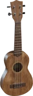
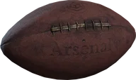
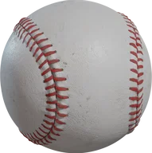
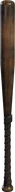
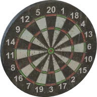
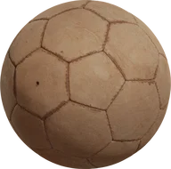
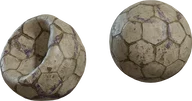
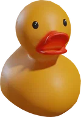
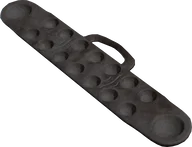
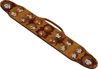

# Poly Haven: Leisure models

**11 assets from [Poly Haven](https://polyhaven.com), dedicated to the public domain under [CC0](https://polyhaven.com/license).** Use them in any game, free or paid, and change them however you like; no credit is needed.

3D models as glTF at 1K and 2K texture resolution, each folder self-contained (`.gltf`, `.bin`, `textures/`). 108.9 MB in all.

This is a copy kept by [zuujis-cc0](https://github.com/zuujis-cc0) so game makers can take single files from GitHub. It is not made by or affiliated with Poly Haven: the originals, often in more formats and higher resolutions, are on [polyhaven.com](https://polyhaven.com). If they help you, consider [supporting Poly Haven](https://www.patreon.com/polyhaven/overview).

Every file is listed in [MANIFEST.tsv](MANIFEST.tsv) with its size and SHA-256. More free assets: [the collection](https://github.com/zuujis-cc0/free-game-assets#readme).

| | | | |
| :-: | :-: | :-: | :-: |
|  <b><a href="Ukulele_01">Ukulele 01</a></b> by Joseph Burgan · <a href="https://polyhaven.com/a/Ukulele_01">source</a> |  <b><a href="american_football">American Football</a></b> by Riley Queen · <a href="https://polyhaven.com/a/american_football">source</a> |  <b><a href="baseball_01">Baseball 01</a></b> by Rico Cilliers · <a href="https://polyhaven.com/a/baseball_01">source</a> |  <b><a href="baseball_bat">Baseball Bat</a></b> by Enrique Martín · <a href="https://polyhaven.com/a/baseball_bat">source</a> |
|  <b><a href="chess_set">Chess Set</a></b> by Riley Queen · <a href="https://polyhaven.com/a/chess_set">source</a> |  <b><a href="dartboard">Dartboard</a></b> by Satyaki Mandal · <a href="https://polyhaven.com/a/dartboard">source</a> |  <b><a href="dirty_football">Dirty Football</a></b> by Rohit Seervi · <a href="https://polyhaven.com/a/dirty_football">source</a> |  <b><a href="football">Football</a></b> by Amal Kumar · <a href="https://polyhaven.com/a/football">source</a> |
|  <b><a href="rubber_duck_toy">Rubber Duck Toy</a></b> by Plat251 · <a href="https://polyhaven.com/a/rubber_duck_toy">source</a> |  <b><a href="sungka_board">Sungka Board</a></b> by Ulan Cabanilla · <a href="https://polyhaven.com/a/sungka_board">source</a> |  <b><a href="sungka_board_02">Sungka Board 02</a></b> by Ulan Cabanilla · <a href="https://polyhaven.com/a/sungka_board_02">source</a> |  |

---

Kept up to date by this repository's own [update workflow](.github/workflows/update.yml), with code and plan from [cc0-mirror](https://github.com/zuujis-cc0/cc0-mirror). Something wrong? [Open an issue there](https://github.com/zuujis-cc0/cc0-mirror/issues/new) or use the [private report form](https://games.zuujis.com/report).
